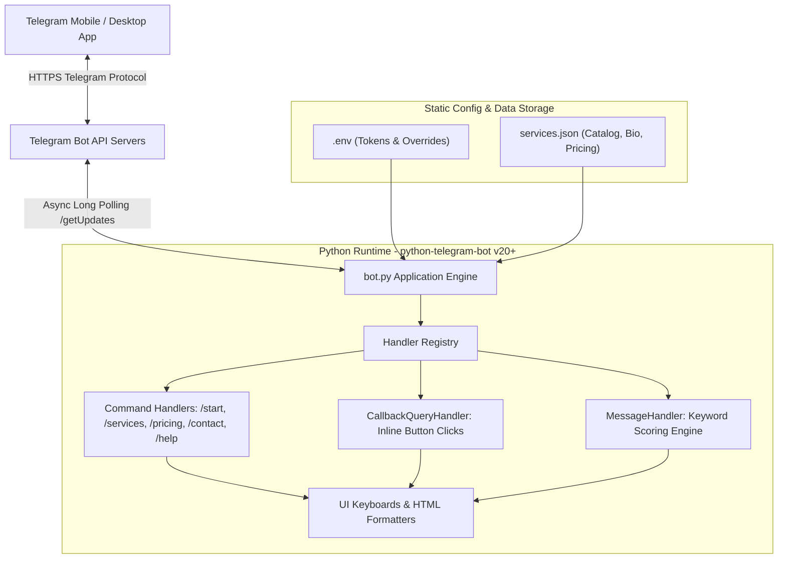
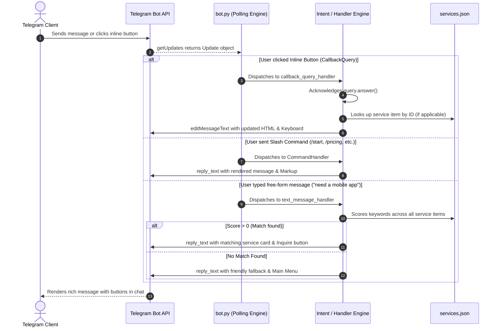
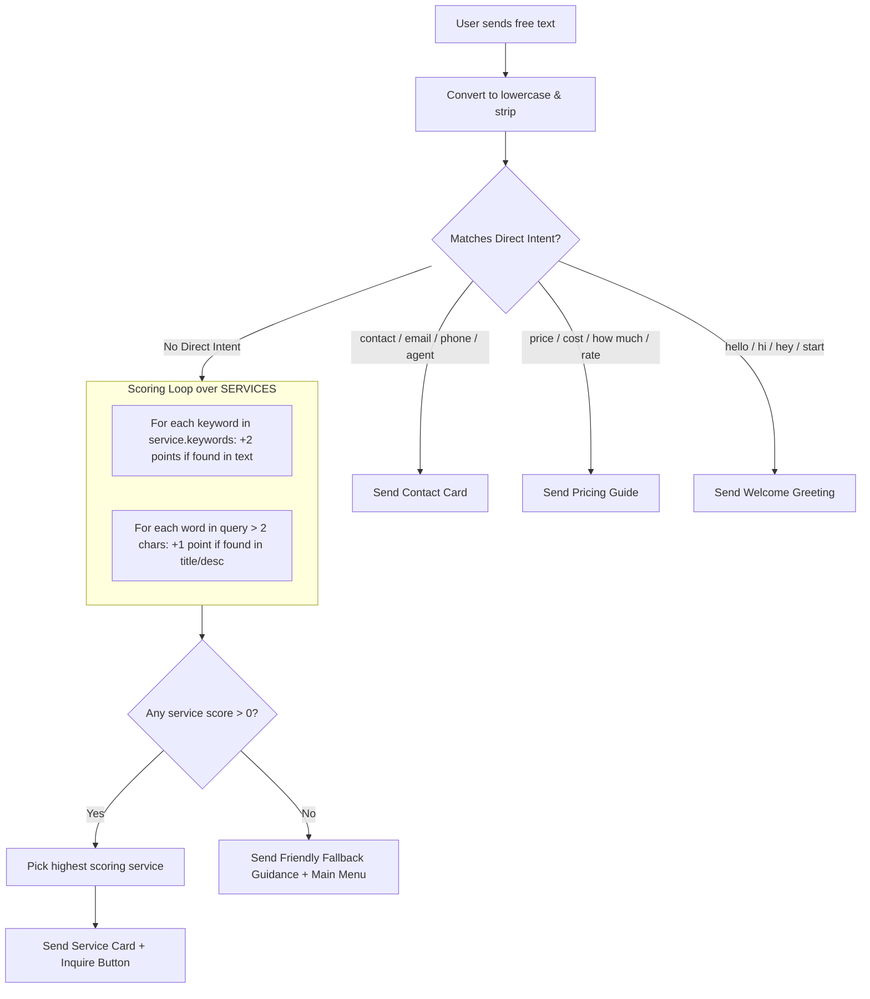

# 🤖 Telegram Personal Assistant & Services Bot

[](https://www.python.org/)
[](https://python-telegram-bot.org/)
[](https://www.docker.com/)
[](LICENSE)

An asynchronous, production-ready Telegram bot designed for freelancers, consultants, digital agencies, and independent creators. It acts as an automated 24/7 digital concierge that showcases service offerings, provides transparent pricing, answers client inquiries using a scoring-based keyword engine, and routes high-intent leads straight to your private inbox.

---

## 📑 Table of Contents

- [Overview & Value Proposition](#-overview--value-proposition)
- [Key Features](#-key-features)
- [System Architecture & Data Flow](#-system-architecture--data-flow)
- [Repository File Structure](#-repository-file-structure)
- [Data Model & Configuration (`services.json`)](#-data-model--configuration-servicesjson)
- [Codebase Deep Dive (`bot.py`)](#-codebase-deep-dive-botpy)
  - [1. Data Loading & Fallback Resolution](#1-data-loading--fallback-resolution)
  - [2. Dynamic UI & Keyboard Builders](#2-dynamic-ui--keyboard-builders)
  - [3. Message Content Formatters](#3-message-content-formatters)
  - [4. Command & Navigation Handlers](#4-command--navigation-handlers)
  - [5. Natural Language Keyword Matching Engine](#5-natural-language-keyword-matching-engine)
  - [6. Application Bootstrap & Polling](#6-application-bootstrap--polling)
- [Step-by-Step Installation & Local Setup](#-step-by-step-installation--local-setup)
  - [Step 1: Obtain a Telegram Bot Token](#step-1-obtain-a-telegram-bot-token)
  - [Step 2: Clone the Repository](#step-2-clone-the-repository)
  - [Step 3: Setup Virtual Environment & Dependencies](#step-3-setup-virtual-environment--dependencies)
  - [Step 4: Configure Environment Variables](#step-4-configure-environment-variables)
  - [Step 5: Run the Bot](#step-5-run-the-bot)
- [Docker & Containerized Deployment](#-docker--containerized-deployment)
- [Cloud & VPS Hosting Recipes](#-cloud--vps-hosting-recipes)
  - [Hosting on Cloud PaaS (Railway, Render, Fly.io, Koyeb)](#hosting-on-cloud-paas-railway-render-flyio-koyeb)
  - [Hosting on Linux VPS (systemd Background Service)](#hosting-on-linux-vps-systemd-background-service)
- [Bot Commands & Interaction Reference](#-bot-commands--interaction-reference)
- [Customization & Extension Guide](#-customization--extension-guide)
  - [Adding or Modifying Services](#adding-or-modifying-services)
  - [Integrating LLM AI Fallback (OpenAI / Gemini)](#integrating-llm-ai-fallback-openai--gemini)
  - [Instant Admin Lead Notifications](#instant-admin-lead-notifications)
- [Troubleshooting & Common Pitfalls](#-troubleshooting--common-pitfalls)

---

## 🌟 Overview & Value Proposition

Freelancers, contractors, and agencies frequently lose potential clients due to delayed responses or friction in discovering service packages and pricing. 

This Telegram Sales & Services Bot solves that friction by providing:
1. **Immediate Discovery**: Prospects can inspect all your capabilities, scope of work, deliverables, and turnaround times in seconds.
2. **Transparent Rates**: Prevents awkward price negotiations by presenting upfront pricing tiers directly within Telegram.
3. **No-Code Content Management**: You can modify your portfolio, deliverables, pricing, and contact information simply by editing a JSON file (`services.json`) without touching any Python code.
4. **Frictionless Handoff**: Connects interested clients straight to your direct Telegram handle (`t.me/<handle>`), email, phone, or website with one click.
5. **Zero Infrastructure Complexity**: Runs on **Long Polling** via `python-telegram-bot` v20+—meaning no public domain, no SSL certificate, no reverse proxy (Nginx/Caddy), and no open firewall ports are required.

---

## ✨ Key Features

| Feature | Description |
| :--- | :--- |
| **Interactive Inline Navigation** | Fluid nested menus with breadcrumbs (`Main Menu` ↔ `Services` ↔ `Service Details` ↔ `Inquiry`). |
| **Dynamic Service Grid** | Automatically renders services into a responsive two-column inline keyboard directly from JSON data. |
| **Heuristic Intent Engine** | Detects intent from free-text messages (e.g., *"how much does a website cost?"* or *"give me Ashwin's email"*) and serves matching details. |
| **Dual Fallback Configuration** | Contact info cascades gracefully: `.env` environment variables take priority, falling back to `services.json`, and finally to sensible defaults. |
| **Direct Lead Conversion** | Generates deep links for instant direct messaging on Telegram, phone/WhatsApp, and email clients. |
| **Docker Ready** | Pre-configured lightweight multi-stage Dockerfile and `docker-compose.yml` for instant, isolated deployment. |

---

## 🏛️ System Architecture & Data Flow

### High-Level Architecture



### Event Dispatch & Interaction Lifecycle



---

## 📁 Repository File Structure

```
tele-service-bot-main/
├── .env.example          # Blueprint for environment variables & secrets
├── .gitignore            # Ignores .env, Python bytecode (__pycache__), and virtualenvs
├── .dockerignore         # Excludes non-essential files from Docker build context
├── Dockerfile            # Container build specification using python:3.11-slim
├── docker-compose.yml    # Single-service Docker Compose orchestrator
├── requirements.txt      # Python runtime dependencies
├── services.json         # Data source: Profile details, services, pricing, and keywords
├── bot.py                # Core application entrypoint, handlers, UI builders, and polling
├── PLAN.md               # High-level architecture and implementation notes
└── README.md             # Complete end-to-end documentation
```

### File Breakdown

- **`bot.py`**: The heart of the bot. Contains initialization, logging setup, data loading, keyboard builders, message template formatters, callback query dispatching, keyword matching heuristics, error handling, and the polling event loop.
- **`services.json`**: The content management catalog. Defines company/profile metadata (name, bio, contact links) and an array of service cards with IDs, icons, titles, descriptions, pricing, deliverables, turnaround periods, and matching keywords.
- **`requirements.txt`**: Pinpoints three core libraries:
  - `python-telegram-bot>=20.0`: The asynchronous Telegram framework.
  - `python-dotenv>=1.0.0`: Parses `.env` configuration files.
  - `httpx>=0.25.0`: Underlying high-performance asynchronous HTTP client used by the Telegram library.
- **`Dockerfile` & `docker-compose.yml`**: Packaged container definitions for single-command deployment on any Docker-compatible server or cloud provider.
- **`.env.example`**: Documents mandatory and optional variables needed to boot the application.

---

## 📊 Data Model & Configuration (`services.json`)

The entire bot content is driven by `services.json`. You can modify your portfolio, deliverables, or rates without editing Python code.

### Schema Blueprint

```json
{
  "company": {
    "name": "Ashwin Vishwakarma",
    "tagline": "AI Automation Specialist & Freelance Consultant",
    "email": "ashwinvishwakarma0657@gmail.com",
    "phone": "+91 7710875332",
    "telegram": "@ashwinvishwakarma",
    "website": "https://yourportfolio.com"
  },
  "services": [
    {
      "id": "web_dev",
      "icon": "🌐",
      "title": "Web & Mobile App Development",
      "short_desc": "Full-stack web apps, mobile apps, and scalable APIs tailored for your project.",
      "full_desc": "I build fast, responsive, and secure web and mobile applications using modern frameworks like React, Next.js, Flutter, and Node.js/Python. From MVPs to full-scale applications, I ensure clean architecture, reliable performance, and great user experience.",
      "pricing": "Starting at $1,200 (MVP) / $3,000+ (Custom Full-Stack)",
      "deliverables": [
        "Responsive Web / Native Mobile App",
        "Clean REST / GraphQL API architecture",
        "Database setup & cloud deployment",
        "30 days post-launch warranty & support"
      ],
      "turnaround": "2 to 5 weeks",
      "keywords": [
        "web",
        "website",
        "app",
        "mobile",
        "ios",
        "android",
        "frontend",
        "backend",
        "fullstack",
        "react",
        "flutter"
      ]
    }
  ]
}
```

### Field Definitions

| JSON Path | Type | Description |
| :--- | :--- | :--- |
| `company.name` | `string` | Your name or agency brand name (used in headers and greetings). |
| `company.tagline` | `string` | Subtitle/headline displayed beneath your name in the `/start` greeting. |
| `company.email` | `string` | Primary business email address. |
| `company.phone` | `string` | Phone or WhatsApp number. |
| `company.telegram` | `string` | Your personal Telegram username (with `@`). Used to generate direct 1-click chat links. |
| `company.website` | `string` | Portfolio or agency URL attached to the Main Menu portfolio button. |
| `services[].id` | `string` | Unique alphanumeric identifier (e.g., `web_dev`, `ai_automation`). Used in inline button callback data. |
| `services[].icon` | `string` | Single emoji character representing the service on menu buttons and headers. |
| `services[].title` | `string` | Full display title for menus and headers. |
| `services[].short_desc` | `string` | One-sentence summary used for quick overviews and keyword scoring. |
| `services[].full_desc` | `string` | Comprehensive description of what you offer under this service. |
| `services[].pricing` | `string` | Human-readable pricing tiers, retainers, or starting rates. |
| `services[].deliverables` | `list[string]` | Concrete checklist of items the client will receive. |
| `services[].turnaround` | `string` | Estimated delivery timeline (e.g., `"1 to 2 weeks"`, `"Monthly retainer"`). |
| `services[].keywords` | `list[string]` | List of trigger words for the heuristic text-matching engine. |

> [!NOTE]
> **Configuration Priority Hierarchy:**
> `bot.py` determines contact variables using the following fallback cascade:
> 1. Environment Variable in `.env` (Highest Priority)
> 2. Value in `services.json` under `profile` or `company`
> 3. Hardcoded safe default inside `bot.py` (Lowest Priority)

---

## 🧩 Codebase Deep Dive (`bot.py`)

Here is an architectural walkthrough of how each module in [`bot.py`](file:///c:/Users/Ashwin/OneDrive/Documents/Michaeal%20Github/tele-service-bot-main/bot.py) operates:

### 1. Data Loading & Fallback Resolution
- **`load_services_data()`**: Reads and parses `services.json` on application startup using `pathlib.Path`. If the file is missing or contains malformed JSON, it logs an error and returns an empty schema rather than crashing.
- **Global Constants**: Parses `CONTACT_EMAIL`, `CONTACT_PHONE`, `CONTACT_TELEGRAM`, and `CONTACT_WEBSITE` using `os.getenv()`, defaulting back to `services.json` values.

### 2. Dynamic UI & Keyboard Builders
The bot constructs custom `InlineKeyboardMarkup` instances for navigation:
- **`build_main_menu_keyboard()`**: Builds a 3-tier menu:
  - Row 1: `📂 View Services` | `💰 Pricing & Rates`
  - Row 2: `📞 Contact Me` | `💬 Chat / Hire Me`
  - Row 3: `🌐 Portfolio / Website` (URL button opening your portfolio link)
- **`build_services_keyboard()`**: Dynamically iterates over the `SERVICES` array and packs services into a **2-column grid** of buttons, followed by navigation buttons to return to the Main Menu or open the Pricing Guide.
- **`build_service_detail_keyboard(service_id)`**: Renders a call-to-action button (`💬 Inquire / Order This`) and back navigation (`⬅️ Back to Services` / `🏠 Main Menu`).
- **`build_back_to_menu_keyboard()`**: Utility navigation bar attached to pricing and contact cards.

### 3. Message Content Formatters
These functions generate HTML-formatted text strings:
- **`format_welcome_message(first_name)`**: Greets the visitor by their Telegram first name and displays the consultant's name and tagline.
- **`format_pricing_message()`**: Consolidates all services, their rate structures, and turnaround timelines into a single organized summary.
- **`format_contact_message()`**: Formats direct channels including clickable `<a href="https://t.me/username">` links, email, phone, and website.
- **`format_service_detail(service)`**: Assembles the complete service dossier: overview, bulleted list of deliverables (`✅ Deliverable`), turnaround time, and pricing.

### 4. Command & Navigation Handlers
- **Commands**:
  - `/start` ➔ Displays the welcome card with the primary navigation keyboard.
  - `/services` ➔ Directly renders the service catalog buttons.
  - `/pricing` ➔ Renders the consolidated pricing guide.
  - `/contact` ➔ Renders the direct contact details.
  - `/help` ➔ Shows available commands and instructions for free-text search.
- **Callback Query Handler (`callback_query_handler`)**:
  - Automatically answers callback queries via `await query.answer()` to dismiss Telegram's loading spinner.
  - Routes `menu_main`, `menu_services`, `menu_pricing`, and `menu_contact` to update messages in place via `query.edit_message_text`.
  - Handles `service_<id>` to pull up detailed service specs.
  - Handles `inquire_<id>` or `inquire_general` to display a custom inquiry card with a direct Telegram DM link (`https://t.me/<username>`).

### 5. Natural Language Keyword Matching Engine
When a visitor writes a message instead of tapping a button, `text_message_handler` processes the input in three stages:



#### Scoring Heuristic Formula:
$$\text{Score}(S) = 2 \times \sum_{k \in S.\text{keywords}} \mathbb{I}(k \in \text{user\_text}) + 1 \times \sum_{w \in \text{user\_words}, |w| > 2} \mathbb{I}(w \in S.\text{title} \lor w \in S.\text{short\_desc})$$

Matches are sorted in descending order of score, ensuring the most relevant service is immediately delivered to the user.

### 6. Application Bootstrap & Polling
- **`main()`**:
  - Checks if `TELEGRAM_BOT_TOKEN` is present and valid; if not, outputs a clear terminal message instructing the user how to configure it.
  - Builds the `Application` instance using `ApplicationBuilder().token(token).build()`.
  - Registers command handlers, callback query handlers, text message filters, and the global error handler (`error_handler`).
  - Calls `application.run_polling()`, establishing an asynchronous non-blocking connection to Telegram's long-polling API.

---

## ⚙️ Step-by-Step Installation & Local Setup

### Step 1: Obtain a Telegram Bot Token

1. Open Telegram and search for [@BotFather](https://t.me/BotFather) (the official bot management bot created by Telegram).
2. Start a chat and send:
   ```text
   /newbot
   ```
3. Follow the prompts:
   - Provide a friendly display name (e.g., `Ashwin Vishwakarma Assistant`).
   - Provide a unique username ending in `bot` (e.g., `ashwin_services_bot`).
4. BotFather will provide an API Token formatted like:
   ```text
   7123456789:AAFlm-gX4abcdef1234567890abcdef
   ```
5. *(Optional but Recommended)* Set command suggestions in BotFather:
   - Send `/setcommands` to `@BotFather`.
   - Select your bot.
   - Paste the following command list:
     ```text
     start - Open welcome greeting and main menu
     services - Browse available services & offerings
     pricing - View pricing guide and turnaround times
     contact - Get direct contact information
     help - Show usage instructions
     ```

---

### Step 2: Clone the Repository

```bash
git clone https://github.com/<your-username>/tele-service-bot-main.git
cd tele-service-bot-main
```

---

### Step 3: Setup Virtual Environment & Dependencies

It is recommended to use an isolated Python virtual environment (`venv`):

#### On Windows (PowerShell):
```powershell
python -m venv venv
.\venv\Scripts\Activate.ps1
pip install --upgrade pip
pip install -r requirements.txt
```

#### On Linux / macOS (bash / zsh):
```bash
python3 -m venv venv
source venv/bin/activate
pip install --upgrade pip
pip install -r requirements.txt
```

---

### Step 4: Configure Environment Variables

Create your local `.env` file by copying the template:

#### Windows (PowerShell):
```powershell
Copy-Item .env.example .env
```

#### Linux / macOS:
```bash
cp .env.example .env
```

Open `.env` in your text editor and populate your settings:

```env
# ===================================================================
# TELEGRAM CONFIGURATION (MANDATORY)
# ===================================================================
TELEGRAM_BOT_TOKEN=7123456789:AAFlm-gX4abcdef1234567890abcdef

# ===================================================================
# OPTIONAL CONTACT OVERRIDES
# (Leave empty to use the values defined in services.json)
# ===================================================================
CONTACT_EMAIL=ashwinvishwakarma0657@gmail.com
CONTACT_PHONE=+91 7710875332
CONTACT_TELEGRAM=@ashwinvishwakarma
CONTACT_WEBSITE=https://yourportfolio.com
```

> [!WARNING]
> Never commit your `.env` file to version control. The `.gitignore` file already excludes `.env` to protect your bot token.

---

### Step 5: Run the Bot

Execute:
```bash
python bot.py
```

You should see logs indicating a successful startup:
```text
2026-10-31 21:45:00,123 - __main__ - INFO - Initializing Ashwin Vishwakarma's Assistant Bot...
2026-10-31 21:45:01,456 - __main__ - INFO - Bot started successfully. Polling for updates...
```

Open your Telegram app, search for your bot's username, and send `/start` to begin interacting!

---

## 🐳 Docker & Containerized Deployment

Using Docker ensures the bot runs identically across any operating system without installing Python or local dependencies.

### Option 1: Run with Docker Compose (Recommended)

Start the bot in detached background mode:
```bash
docker compose up -d --build
```

View real-time logs:
```bash
docker compose logs -f
```

Stop the bot:
```bash
docker compose down
```

### Option 2: Run with Plain Docker CLI

1. **Build the image**:
   ```bash
   docker build -t tele-service-bot:latest .
   ```

2. **Run container with your `.env` file**:
   ```bash
   docker run -d --name tele-service-bot --env-file .env --restart unless-stopped tele-service-bot:latest
   ```

3. **Check container status and logs**:
   ```bash
   docker ps
   docker logs -f tele-service-bot
   ```

---

## ☁️ Cloud & VPS Hosting Recipes

Because this bot uses **Long Polling** (`getUpdates`), it creates an outgoing HTTPS connection to Telegram's servers. **You do NOT need:**
- A public static IP address
- An open inbound port
- An SSL certificate
- A reverse proxy like Nginx

### Hosting on Cloud PaaS (Railway, Render, Fly.io, Koyeb)

1. Push your repository to GitHub (ensure `.env` is NOT pushed).
2. Connect your repository to your PaaS platform (e.g., [Railway.app](https://railway.app), [Render.com](https://render.com), [Fly.io](https://fly.io), or [Koyeb.com](https://koyeb.com)).
3. Configure the platform to run:
   - **Environment**: Docker or Python
   - **Start Command**: `python bot.py`
4. In the platform's **Environment Variables / Secrets** dashboard, add:
   - `TELEGRAM_BOT_TOKEN` = `your_token_from_botfather`
5. Deploy. The platform will build and run the bot continuously.

---

### Hosting on Linux VPS (systemd Background Service)

For an Ubuntu/Debian VPS, configure `systemd` to keep the bot alive across reboots and crashes:

1. Connect to your VPS and clone the repository:
   ```bash
   cd /opt
   sudo git clone https://github.com/<your-username>/tele-service-bot-main.git bot
   cd /opt/bot
   sudo python3 -m venv venv
   sudo ./venv/bin/pip install -r requirements.txt
   sudo cp .env.example .env
   sudo nano .env  # Enter your real bot token
   ```

2. Create a systemd service file:
   ```bash
   sudo nano /etc/systemd/system/telebot.service
   ```

3. Paste the following configuration:
   ```ini
   [Unit]
   Description=Telegram Services & Sales Bot
   After=network.target

   [Service]
   Type=simple
   User=root
   WorkingDirectory=/opt/bot
   ExecStart=/opt/bot/venv/bin/python /opt/bot/bot.py
   Restart=always
   RestartSec=5
   EnvironmentFile=/opt/bot/.env

   [Install]
   WantedBy=multi-user.target
   ```

4. Enable and start the service:
   ```bash
   sudo systemctl daemon-reload
   sudo systemctl enable telebot.service
   sudo systemctl start telebot.service
   ```

5. Inspect live status and logs:
   ```bash
   sudo systemctl status telebot.service
   sudo journalctl -u telebot.service -f
   ```

---

## 🛠️ Bot Commands & Interaction Reference

### Slash Commands

| Command | Action | Output / Behavior |
| :--- | :--- | :--- |
| `/start` | Welcome Screen | Sends introduction card with consultant name, tagline, and full interactive main menu. |
| `/services` | Service Catalog | Renders 2-column inline keyboard with all services listed in `services.json`. |
| `/pricing` | Rates Overview | Lists every service with pricing tiers and typical turnaround times. |
| `/contact` | Contact Channels | Formats email, phone/WhatsApp, Telegram direct link, and portfolio link. |
| `/help` | User Guide | Displays available slash commands and guides user on asking free-text questions. |

### Inline Button Actions

| Callback Data Prefix | Handled By | Action |
| :--- | :--- | :--- |
| `menu_main` | `callback_query_handler` | Edits message back to the primary welcome view. |
| `menu_services` | `callback_query_handler` | Edits message to display the service grid. |
| `menu_pricing` | `callback_query_handler` | Edits message to display the pricing guide. |
| `menu_contact` | `callback_query_handler` | Edits message to display contact channels. |
| `service_<id>` | `callback_query_handler` | Displays detailed specification, deliverables checklist, rate, and inquiry button for service `<id>`. |
| `inquire_<id>` | `callback_query_handler` | Displays personalized inquiry card with a 1-click direct link to message you on Telegram. |

### Natural Language Keyword Triggers

Visitors can type natural questions instead of using buttons. Examples:

| What User Sends | Trigger Detected | Bot Action |
| :--- | :--- | :--- |
| *"How can I call you?"* | `call`, `contact` | Delivers contact card with phone, email, and Telegram link. |
| *"What are your rates?"* | `rates`, `price` | Delivers consolidated pricing guide. |
| *"Can you build a React website for me?"* | `react`, `website` | Delivers Web & Mobile App Development card. |
| *"Do you build AI chatbots or Telegram bots?"* | `ai`, `bot`, `chatbot` | Delivers AI & Automation Solutions card. |
| *"Need help with SEO and Google Ads"* | `seo`, `ads` | Delivers Digital Marketing & SEO card. |
| *"Can you design my Figma UI?"* | `design`, `figma`, `ui` | Delivers UI/UX & Brand Identity card. |
| *"Help setting up AWS and Docker"* | `aws`, `docker` | Delivers Cloud Infrastructure & DevOps card. |

---

## 🔧 Customization & Extension Guide

### Adding or Modifying Services

To add a new service (e.g., *Smart Contract Development*), open `services.json` and append a new object to the `"services"` array:

```json
{
  "id": "smart_contracts",
  "icon": "⚡",
  "title": "Smart Contract & Web3 Development",
  "short_desc": "Solidity and EVM smart contracts, security audits, and decentralized applications.",
  "full_desc": "End-to-end Web3 development including audited Solidity smart contracts, ERC-20 / ERC-721 token standards, and wagmi/viem frontend integration.",
  "pricing": "Starting at $2,000 (Contract + Test Suite)",
  "deliverables": [
    "Audited Solidity smart contracts",
    "Foundry / Hardhat comprehensive test suite",
    "Testnet deployment and verification",
    "Frontend integration assistance"
  ],
  "turnaround": "2 to 3 weeks",
  "keywords": [
    "web3",
    "crypto",
    "blockchain",
    "solidity",
    "ethereum",
    "smart contract",
    "nft",
    "defi"
  ]
}
```
> [!TIP]
> After editing `services.json`, restart the bot process (`python bot.py` or `docker compose restart`) for changes to take effect immediately.

---

### Integrating LLM AI Fallback (OpenAI / Gemini)

If a user asks a question that does not match any keyword, you can forward the query to an LLM like OpenAI or Google Gemini. 

In `bot.py`, locate the fallback section inside `text_message_handler`:

```python
# Inside text_message_handler() in bot.py
if matched_services:
    # Existing keyword presentation code...
else:
    # Optional LLM integration point
    # prompt = f"User asks: '{update.message.text}'. Based on services: {SERVICES}, provide a helpful response."
    # ai_reply = await call_gemini_or_openai(prompt)
    # await update.message.reply_text(ai_reply, parse_mode=ParseMode.HTML)

    fallback_text = (
        f"🤔 I'm not sure I understood your question completely.\n\n"
        f"Would you like to browse my services or chat with me directly?"
    )
    await update.message.reply_text(
        fallback_text,
        reply_markup=build_main_menu_keyboard(),
        parse_mode=ParseMode.HTML,
    )
```

---

### Instant Admin Lead Notifications

When a user taps **Inquire** or sends a custom project scope, you can configure the bot to forward a copy of the inquiry to your personal Telegram Chat ID:

1. Obtain your personal numeric Telegram Chat ID using [@userinfobot](https://t.me/userinfobot).
2. Add `ADMIN_CHAT_ID=12345678` to `.env`.
3. In `callback_query_handler` (under `inquire_`):
   ```python
   admin_id = os.getenv("ADMIN_CHAT_ID")
   if admin_id:
       await context.bot.send_message(
           chat_id=admin_id,
           text=f"🔔 <b>New Lead Alert!</b>\nUser @{user.username} ({user.full_name}) inquired about: <b>{service_title}</b>",
           parse_mode=ParseMode.HTML,
       )
   ```

---

## 🛡️ Troubleshooting & Common Pitfalls

### 1. `TELEGRAM_BOT_TOKEN is missing or not set in .env!`
- **Cause**: The `.env` file either does not exist, contains default placeholder text (`your_telegram_bot_token_here`), or is located in a different directory than `bot.py`.
- **Solution**: Ensure your file is named exactly `.env` (not `.env.txt`) in the root project folder, and paste your token from `@BotFather`.

### 2. `telegram.error.Conflict: Terminated by other getUpdates request`
- **Cause**: Another instance of your bot is already running with the same token (e.g., a background terminal, Docker container, or cloud deployment).
- **Solution**: Terminate all other running instances before starting a new one:
  ```bash
  # Check and stop existing Docker containers
  docker compose down
  # Or on Linux, find and kill rogue python processes
  pkill -f "python.*bot.py"
  ```

### 3. `telegram.error.InvalidToken: Unauthorized`
- **Cause**: The token entered into `.env` contains typos, missing characters, or was revoked in `@BotFather`.
- **Solution**: Re-copy the token from `@BotFather` or regenerate it using `/token`.

### 4. `services.json not found`
- **Cause**: The working directory does not contain `services.json`.
- **Solution**: Ensure `services.json` is in the same directory as `bot.py`. `bot.py` uses `BASE_DIR = Path(__file__).resolve().parent` to reliably resolve files regardless of your terminal's working directory.

### 5. Windows PowerShell Execution Policy Error with `venv`
- **Error**: `.\venv\Scripts\Activate.ps1 cannot be loaded because running scripts is disabled on this system.`
- **Solution**: Run this PowerShell command once to enable local script execution:
  ```powershell
  Set-ExecutionPolicy -ExecutionPolicy RemoteSigned -Scope CurrentUser
  ```

---

## 📄 License & Attribution

This project is licensed under the **MIT License**. You are free to modify, distribute, and use it for personal or commercial client acquisition.

Developed with ❤️ using [python-telegram-bot](https://python-telegram-bot.org/).
